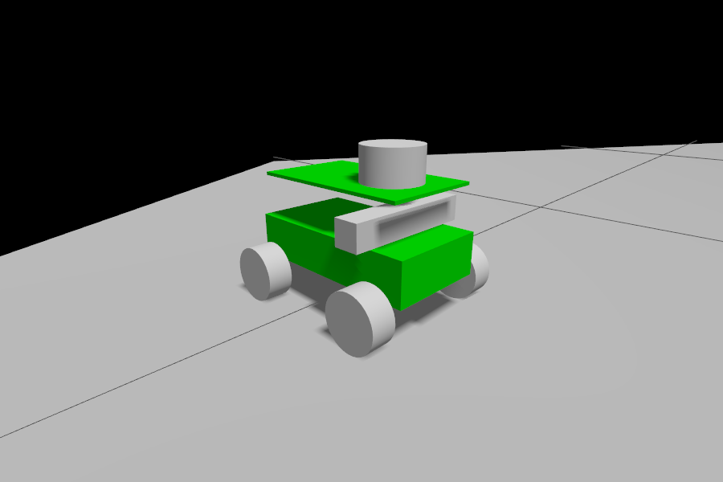
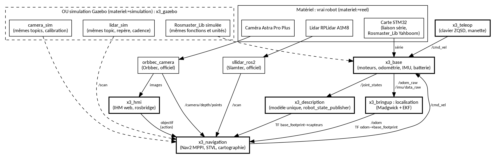

# rosmaster_x3_mecanum_jazzy

**Logiciel ROS 2 complet pour le robot mobile Yahboom ROSMASTER X3 : le même code sur le vrai robot et en simulation.**


<p align="center">
  
  <br><em>Le X3 dans la simulation Gazebo : base mécanum, lidar sur le plateau supérieur, caméra de profondeur en façade.</em>
</p>

---

## Le projet en bref

Le ROSMASTER X3 est un petit robot à **roues mécanum** (il avance, tourne et se déplace en crabe) équipé d'un
**Raspberry Pi 4**, d'un **lidar RPLidar A1M8** et d'une **caméra de profondeur Orbbec Astra Pro Plus**. Le fabricant
le livre avec un logiciel ROS 2 Foxy (2020, fin de vie en 2023), dans un conteneur Docker, mêlant le code de trois
robots différents.

Ce dépôt est une **réécriture propre pour ROS 2 Jazzy** (version à support long, jusqu'en 2029), organisée comme un
projet ROS professionnel :

- **Un seul modèle du robot** pour le vrai robot, la simulation et RViz.
- **La simulation ne remplace que le matériel**, au plus bas niveau : la carte moteur, le lidar et la caméra sont
  simulés avec les mêmes topics, repères, formats et cadences que les vrais. Tout le reste (pilote de base,
  localisation, navigation, interface) est **le même code avec les mêmes réglages**.
- **Navigation Nav2** avec le contrôleur MPPI, qui exploite le déplacement en crabe, et une couche d'obstacles 3D
  alimentée par la caméra de profondeur.
- **Pilotes officiels** des capteurs (Slamtec pour le lidar, Orbbec pour la caméra), versions figées.
- **Robot autonome** : tout tourne sur le Pi, le PC ne sert qu'à visualiser ; carte SD reproductible.

## Ce qui marche aujourd'hui

| Brique | Simulation | Vrai robot |
|---|---|---|
| Modèle unique, arbre des repères | ✅ | ✅ identique au robot, vérifié |
| Pilote de base (moteurs, odométrie, IMU) | ✅ mouvement mesuré contre la vérité Gazebo | ⏳ non testé (carte moteur du robot de développement hors service) |
| Lidar | ✅ 1080 points, 7,5 Hz, comme le vrai | ✅ 7,2-7,7 Hz, 1080 points |
| Caméra couleur + profondeur | ✅ calibration du vrai capteur | ✅ pilote Orbbec officiel : couleur et profondeur 30 images/s, nuage 16,8/s |
| Localisation (EKF roues + IMU) | ✅ | ⏳ dépend de la carte moteur |
| Navigation Nav2 MPPI | ✅ mission de référence 5/5, écart moyen 5,4 cm, 2,0° | ⏳ |
| Cartographie slam_toolbox | ✅ | ⏳ |
| Conduite au clavier, IHM web, démarrage automatique | ⏳ en cours de migration | ⏳ |

## Architecture

<p align="center">
  
</p>

Les blocs en trait épais sont les paquets de ce dépôt ; en pointillés, ce que la simulation remplace.

| Paquet | Rôle |
|---|---|
| [`x3_description`](x3_description) | Modèle unique du robot (xacro) : géométrie, repères des capteurs |
| [`x3_base`](x3_base) | Pilote de la carte STM32 : `/cmd_vel` → moteurs, odométrie, IMU, batterie ; carte réelle ou simulée |
| [`x3_bringup`](x3_bringup) | Démarrage du robot : modèle, base, lidar, caméra, localisation (Madgwick + EKF) |
| [`x3_navigation`](x3_navigation) | Navigation Nav2 (MPPI, STVL, surveillance des collisions) et cartographie |
| [`x3_gazebo`](x3_gazebo) | Simulation Gazebo : monde et remplaçants du matériel |
| [`x3_teleop`](x3_teleop) | Conduite au clavier et à la manette *(en cours)* |
| [`x3_hmi`](x3_hmi) | Interface web *(en cours)* |
| [`x3_tools`](x3_tools) | Mesure : empreinte des capteurs, missions de navigation, tests de mouvement |
| [`deploy`](deploy) | Carte SD du robot, installation, compilation protégée, envoi vers le Pi |

**Repères** (REP-105) : `map` → `odom` → `base_footprint` → `base_link` → `laser` (lidar, monté à 180°),
`camera_link` → `camera_{color,depth}_optical_frame`, `imu_link`, roues.

**Principaux topics** : `/cmd_vel`, `/odom`, `/scan`, `/imu/data`, `/camera/color/image_raw`,
`/camera/depth/image_raw`, `/camera/depth/points`, `/voltage`.

## Démarrage rapide (simulation)

Sur un PC Ubuntu 24.04 avec ROS 2 Jazzy et Gazebo Harmonic :

```bash
mkdir -p ~/x3_ws/src && cd ~/x3_ws/src
git clone https://github.com/zubulmuk92/rosmaster_x3_mecanum_jazzy.git
cd ~/x3_ws
vcs import src < src/rosmaster_x3_mecanum_jazzy/dependencies.repos   # pilotes officiels, versions figées
rosdep install --from-paths src --ignore-src -y
colcon build && source install/setup.bash

ros2 launch x3_gazebo simulation.launch.py                  # terminal 1 : le robot simulé
ros2 launch x3_navigation navigation.launch.py              # terminal 2 : Nav2 + RViz
```

Dans RViz, l'outil **Nav2 Goal** envoie le robot où l'on clique. Pour faire une carte :
`ros2 launch x3_navigation cartographie.launch.py`, puis
`ros2 run nav2_map_server map_saver_cli -f ~/cartes/ma_salle`.

Options utiles : `simulation.launch.py gui:=false camera:=true`,
`navigation.launch.py carte:=/chemin/carte.yaml vitesse:=prudent|normal|rapide`.

## Sur le vrai robot

Le robot tourne sous **Ubuntu 24.04 Server** sur son Raspberry Pi 4. La carte SD se prépare depuis le PC
(`deploy/`) : écriture de l'image Ubuntu, premier démarrage automatique (cloud-init) qui installe ROS 2 Jazzy et
les dépendances, règles udev des capteurs, protections contre les blocages (swap, earlyoom, watchdog matériel).
Le PC et le robot se parlent par un câble Ethernet direct (le PC partage sa connexion), sur le domaine ROS 92.

```bash
ros2 launch x3_bringup robot.launch.py        # sur le robot : modèle, base, lidar, caméra, localisation
ros2 launch x3_navigation navigation.launch.py carte:=/chemin/carte.yaml
```

### Fichiers du fabricant (non inclus)

Le logiciel Yahboom n'a pas de licence : ce dépôt **n'en redistribue rien**. Deux éléments restent nécessaires ou
utiles, à récupérer depuis le logiciel livré avec le robot (image de la carte SD ou téléchargements Yahboom) :

- **`Rosmaster_Lib`**, la bibliothèque série de la carte moteur STM32, indispensable sur le vrai robot ;
- les **pièces 3D** du X3, facultatives, pour un affichage réaliste dans RViz (sinon : formes simples).

```bash
bash deploy/recuperer_yahboom.sh <dossier yahboomcar_description> [<dossier py_install de Rosmaster_Lib>]
```

Ils sont copiés dans des emplacements ignorés par git.

## Choix techniques

- **Pas de ros2_control** : la carte STM32 régule elle-même la vitesse du robot entier (elle reçoit vx, vy, ω).
  `x3_base` garde ce principe, et la simulation remplace exactement cette carte.
- **Nav2 sur le Pi** : les flux bruts de la caméra (le nuage de points pèse 4,9 Mo) saturent un lien gigabit s'ils
  sortent du robot ; ils restent donc dans le Pi, et le PC ne reçoit que de quoi visualiser.
- **Horloge système en simulation** : comme sur le robot, les mesures sont horodatées à la réception ; la carte
  simulée corrige le facteur temps réel de Gazebo.
- **Mesures plutôt qu'impressions** : `x3_tools` relève l'empreinte des capteurs (simulation contre vrai robot),
  rejoue des missions de navigation et compare l'odométrie à la position réelle dans Gazebo.

## Remerciements

[Yahboom](https://www.yahboom.net/) pour le robot et son logiciel d'origine, dont ce projet reprend les principes ;
[Slamtec](https://github.com/Slamtec/sllidar_ros2) et [Orbbec](https://github.com/orbbec/OrbbecSDK_ROS2) pour les
pilotes des capteurs ; [Nav2](https://nav2.org/), [slam_toolbox](https://github.com/SteveMacenski/slam_toolbox) et
[robot_localization](https://github.com/cra-ros-pkg/robot_localization).

## Licence

[Apache-2.0](LICENSE) pour le code de ce dépôt. Les dépendances gardent leur propre licence (pilote Slamtec :
BSD-2-Clause ; pilote Orbbec : Apache-2.0 ; slam_toolbox : LGPL-2.1).
